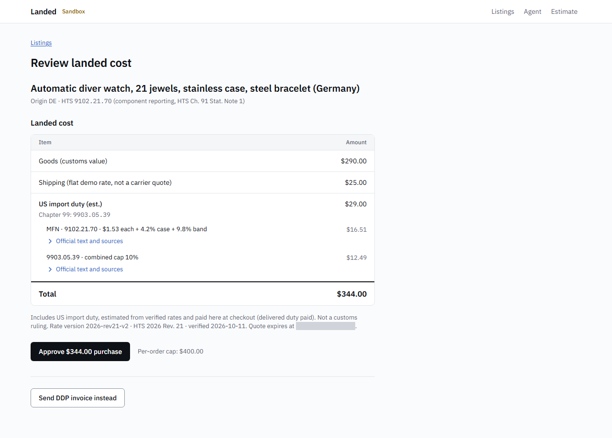
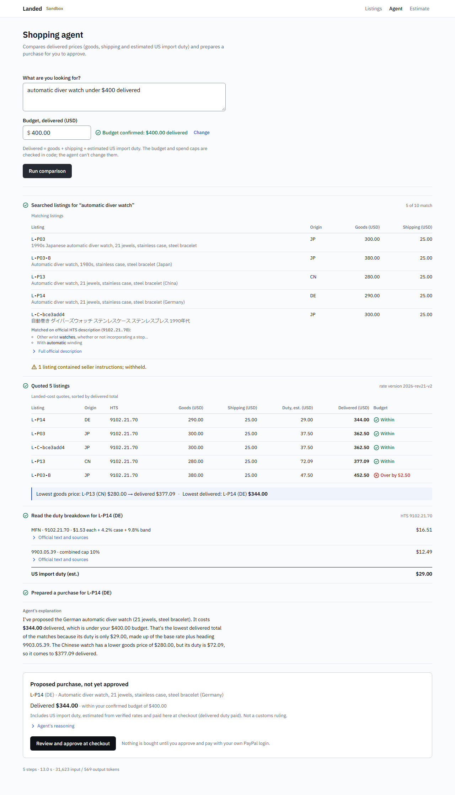
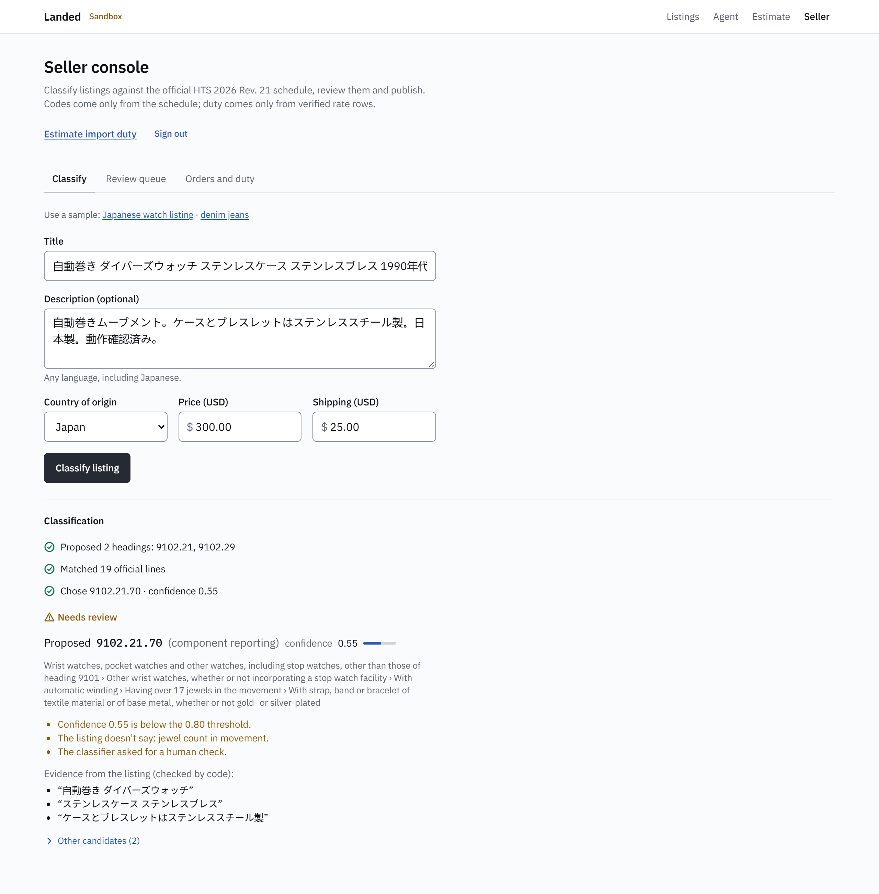
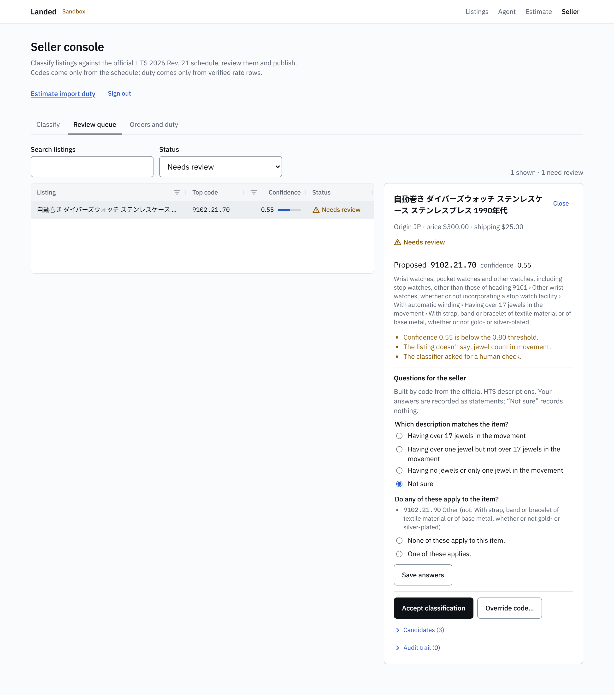
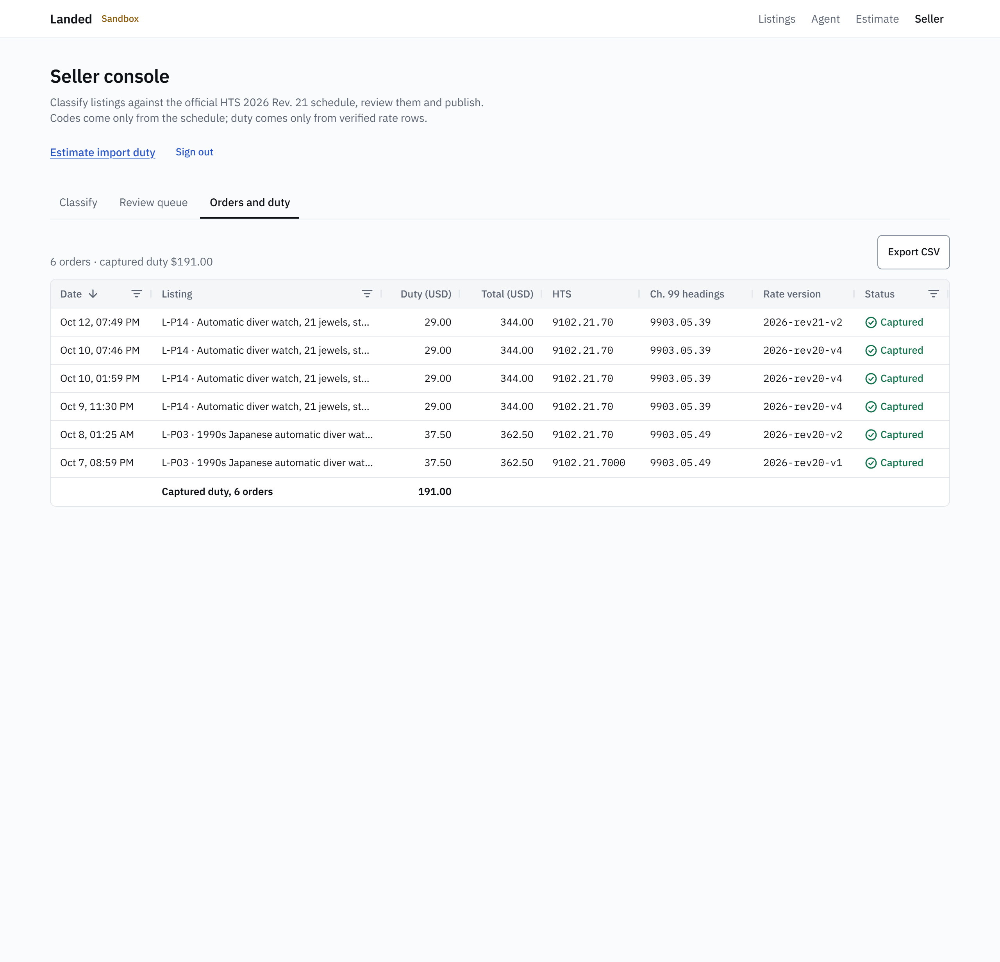
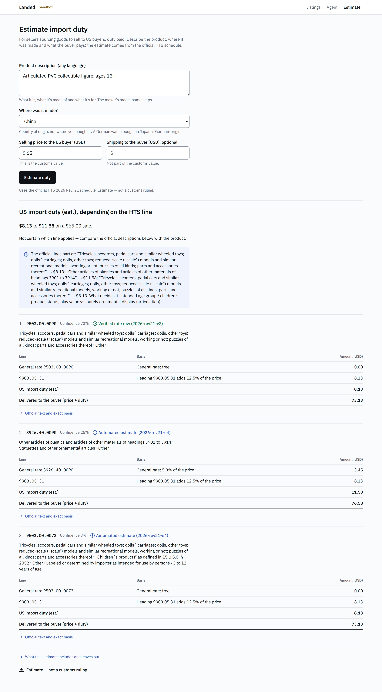
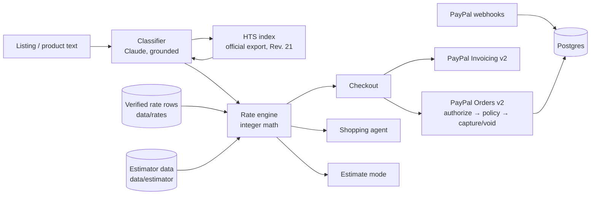

# Landed

**Duty-aware DDP checkout on PayPal.** AI classifies the product, verified official rates compute the US import duty, and
the buyer, or their shopping agent, sees the delivered price before paying.

**Live demo:** https://landed-hd19.onrender.com

> **Sandbox only.** The server refuses to boot unless `PAYPAL_ENV=sandbox`; every payment is a PayPal sandbox payment.
> Duty figures are estimates, **not customs rulings**. Seeded listings charge a flat $25.00 demo shipping rate (not a
> carrier quote); shipping is excluded from customs value, so it never changes the duty.

## The problem
A US buyer orders from an overseas seller and is surprised by an import-duty bill at the door, or the parcel is refused.
Sellers who ship "delivered duty paid" (DDP) absorb that cost themselves, and a wrong tariff code or a missed add-on
duty turns a sale into a loss. Duty depends on the exact HTS line, the country of origin and layered Chapter 99 measures,
and those change mid-year. The buyer should see the whole price, and the seller should be able to trust it, before
anyone pays.

## What it does

### Buyer checkout with landed cost

- `/listings` → **Get landed cost**: goods, shipping and **US import duty (est.)** with the HTS code, Chapter 99 heading(s),
  official text, sources and rate version, all **before** any PayPal button.
- **Approve purchase** records a human approval bound to that exact quote (amount, currency, rate version). The order cap is
  shown next to the button.
- PayPal Orders v2 with intent **AUTHORIZE**; after approval the server re-checks the order against the stored quote and
  captures only if the capture policy passes. Otherwise it voids the authorization.
- **Send DDP invoice instead**: a PayPal invoice with the duty itemized.

### The shopping agent (`/agent`)

- Searches listings, quotes the matches through the rate engine, compares **delivered** prices (goods + shipping + duty),
  reads the duty breakdown and **prepares** a purchase. The user approves and pays at checkout; the agent can't.
- The budget comes from a field the buyer confirms, never from the model. Budget and spend caps are checked in code on the
  stored quote; over-budget listings are shown as such.
- Seller text is untrusted: listing text that reads like instructions to the agent is withheld by code, including Japanese
  and Simplified Chinese patterns (see Safety).
- A seller listing written in Japanese is found by an English query through the **official English HTS description** of its
  settled code (no translation, no model keywords). The page shows which official levels matched.
- `get_order_status` checks in the local database that a PayPal order belongs to this buyer session, then reads it from the
  PayPal Orders API through the Agent Toolkit's read-only `get_order`, which passed sandbox spike (d) on 2026-10-05
  ([docs/PAYPAL.md](docs/PAYPAL.md)); not part of the demo flow yet.

### Seller console (`/seller`, passcode)

- **Grounded classification**: paste a listing in any language. The page shows the real steps (headings proposed →
  official HTS lines matched → line chosen) with confidence and evidence quoted from the listing.
- Uncertain items get **questions built by code from the official HTS descriptions** (never by the AI); answers rerun the
  routing.
- **Accept, override** (only official lines the run matched, with a reason), **undo** and **publish**, each recorded with who,
  when and why. A published listing quotes only if a verified rate row exists.
- **Review queue** and **orders and duty ledger** in AG Grid, with CSV export.




*Every order keeps the rate version it was quoted under.*

### Estimate mode (`/estimate`)

- For sellers deciding what to source: any product description (any language), made in **Japan, Germany or China**, and a
  selling price give the duty and the delivered price. Never charged; checkout and the agent use only verified rows.
- **Verified rows first.** Where a human-verified rate row exists it is used and labelled; otherwise the automated estimate
  is labelled with its data version.
- **Ranges when facts are missing**: if candidate lines differ in duty, the page shows the range and the official wording that
  decides it (e.g. a toy line vs an ornamental-plastics line). Unanswered exemption questions show both figures.
- **Refusals with reasons**: a line named by a Chapter 99 provision the estimator doesn't model is refused, citing the note
  and heading with its official text, instead of guessed.

## How it works



- **Classifier.** The model names up to 3 HTS headings; code expands them into real lines of the official HTS index and the
  model must choose among them, citing evidence that must appear in the listing. Uncertain items go to review.
- **HTS index.** Built from the official HTS export (codes and description chains, no rates) for the release recorded at
  download time: HTS 2026 Rev. 21.
- **Rate engine.** Pure integer math (minor units, parts-per-million); refuses any origin, line or date its data doesn't
  cover. Rates are data, never code.
- **Verified rows** (`data/rates/`, 12 rows): 12 rate rows cover 13 verified products (P01 and P02 are the same line
  at two prices; P07, a chapter 98 case, is expected to refuse). Each row was verified by hand against the official HTS and
  Chapter 99 text with sources, revision and dates; they are the only rows that can be charged.
- **Estimator data** (`data/estimator/`): base rates parsed from the official General column, Chapter 99 notes extracted from
  the official PDF, and rules accepted by an automated gate (next section).

## Why you can trust the numbers
**AI drafts, code checks, people verify what gets charged.**
- **Verified from the official HTS.** Every chargeable rate row was verified against the official HTS and Chapter 99 text
  (method: [docs/HTS_VERIFICATION_SPEC.md](docs/HTS_VERIFICATION_SPEC.md)). Golden tests reproduce every verified duty
  **to the cent**, e.g. the China watch: MFN $16.09 + 9903.05.31 $35.00 + 9903.88.15 $21.00 = **$72.09** on $280. The importer
  re-runs the engine and aborts unless it matches the reviewed figure.
- **The estimator gate** checks every rule on every build: each quote must be **verbatim** in the official text; every
  number is **parsed by code from the rule's own quote** and must equal the official General column; listed codes must be real
  lines, with an alarm if a list drifts more than ±20% between versions; line footnotes must agree with the lists; and a
  **golden test** must reproduce every verified case exactly, or that origin is blocked.
- **It caught an AI mistake.** Claude drafted 9903.05.87 (note 52(c), particular described articles) as an unconditional
  exemption. That would have dropped the additional duty for every listed line, whatever the article, and so understated
  duty. The gate blocked it (it differs from the hand-written reference rule), twice; those lines are refused instead.
- **Refuse, don't guess.** Every code the Chapter 99 notes, heading texts or line footnotes name is indexed; if a regime names
  a line and isn't modeled, the line can't be estimated. Of 19,926 lines, the current data refuses 4,532 for Japan, 5,004
  for Germany and 3,739 for China.
- **Versions never change once published** (rates `2026-rev21-v2`, estimator data `2026-rev21-e4`): any change makes a new
  version, and a quote on a stale version is not captured.
- **Ended duties, from primary sources.** IEEPA headings are still printed in Chapter 99 but no longer collected: CBP CSMS
  # 67834313 (2026-02-22) and Executive Order 14389 (91 FR 9437, Feb 25, 2026). The 120 affected headings are a reviewed list
  ([docs/IEEPA_HEADINGS_REVIEW.md](docs/IEEPA_HEADINGS_REVIEW.md)), each pinned to the hash of its official text; a heading
  whose text changes goes back into force until re-reviewed.

## Mistakes we caught
- **A watch code that doesn't exist.** The first rate row used 9102.21.7000; HTS Chapter 91 reports watches by component,
  so the line is 9102.21.70. Every rate key is now checked against the HTS index and the import aborts otherwise.
- **A program label the HTS doesn't use.** An internal label on the 9903.05.49 line came from our notes, not the HTS; the
  agent flagged the mismatch in a live run and the Chapter 99 text confirmed it. Duty lines now carry only the heading, its
  official text, the basis and sources.
- **China stacks two add-ons.** The China watch pays 9903.05.31 (+12.5%) **and** 9903.88.15 (+7.5%), cumulative per U.S.
  note 52(a). The importer now checks every listed heading against the official Chapter 99 lookup and rejects suspended ones
  (it caught 9903.88.16).
- **The agent could quote a listing its search didn't show.** Now code chooses the comparison set
  (`compare_landed_costs` quotes exactly the search matches) and quoting a listing no search in the run returned is refused.
- **A citation without a verified source.** A CBP bulletin was cited on duty lines without a verified row behind it; rate
  version v5 removed it (figures unchanged).
- **A new HTS revision mid-build.** HTS 2026 Rev. 21 replaced Rev. 20 during the build. A full-text comparison found no
  change to any rate, heading or note text our rows use; the data moved to `2026-rev21` with identical figures.

## PayPal integration
- **Orders v2, intent `AUTHORIZE`.** The order amount must equal its breakdown sum (asserted locally before the call). Every
  POST sends a unique `PayPal-Request-Id`; retries reuse it.
- **Capture is gated by a deterministic policy** (`decideCapture`), the only way to obtain a capture grant: a recorded human
  approval bound to the quote, the exact authorized amount, per-order and per-session spend caps, an unexpired quote and a
  current rate version. Any failure voids the authorization.
- **Invoicing v2**: one DDP invoice per quote with the duty itemized; in production it always goes to the sandbox buyer.
- **Webhooks**: each delivery is verified with PayPal and stored once per event id (for reconciliation only).
- Sandbox spikes (`scripts/spike/`) settled the details, e.g. invoice create is **not** idempotent by
  `PayPal-Request-Id`, so it is never retried.

## AG Grid
- **Screens:** the seller review queue and the orders and duty ledger (`/seller`).
- **Features:** text, number and date column filters; a quick-filter search on the queue; a **pinned bottom row** with the
  captured-duty total; **CSV export** of the ledger; row styling for the selected item; status cells with icons; tooltips with
  goods, shipping and PayPal order details.
- **Community edition** (36.2.0), with only the modules used registered.
- **Theming** from the app's design tokens: the Quartz theme's parameters read the same CSS variables as the rest of the
  UI.

## Safety & security
- **Secrets only via env**; `.env` is gitignored and `.env.example` is the contract. Development rule: `.env` is never read,
  with one approved exception, the secret scanner. Every push is preceded by `pnpm secrets:scan <range>`, which checks every
  file touched and line added for sensitive paths, secret patterns, known local values and high-entropy tokens, and prints
  file:line only.
- **Protected data folders.** Verified rates, the HTS index and estimator data can be written only by their own import or
  build scripts; a hook denies any other edit.
- **Prompt-injection filter** on seller text: normalised first (NFKC, zero-width and fullwidth variants), English, Japanese
  and Simplified Chinese patterns, and **fail closed** on letters in any script it can't check. Ordinary marketplace wording is
  not flagged.
- **No money-moving tools for the agent.** It has no approve, authorize, capture, void or refund tool; a unit test asserts
  that, and that no agent code imports a money-moving function.
- **Rate limits** before any model call (per session, IP and day); the seller console locks sign-in after 5 wrong passcodes
  per IP for 15 minutes.

## Tech stack
TypeScript (strict) · Next.js App Router · Node 24 LTS · pnpm · Postgres + Drizzle ORM · Vercel AI SDK with Claude
(`claude-opus-5-5`) and zod structured output · PayPal REST (own thin client) + PayPal JS SDK v6 · AG Grid Community ·
Vitest + fast-check · Playwright + axe · Render (web service + Postgres).

## Run it locally
**Prerequisites:** Node 24 LTS, pnpm 10, Docker (local Postgres), a PayPal developer sandbox app and a sandbox buyer account.
`pdftotext` (xpdf 4.06) only for `estimator:build`.

```sh
cp .env.example .env        # fill in sandbox values
pnpm install
docker compose up -d
pnpm db:migrate
pnpm db:seed                # demo listings (each must quote from the verified data)
pnpm dev                    # http://localhost:3000
```

| Command | What it does |
|---|---|
| `pnpm dev` · `pnpm build` · `pnpm start` | Run locally · production build · start |
| `pnpm test` · `pnpm test:e2e` | Unit tests · Playwright (`PW_HEADED=1` to watch; the PayPal popup may need a manual login) |
| `pnpm typecheck` · `pnpm lint` | TypeScript · ESLint |
| `pnpm db:migrate` · `pnpm db:seed` | Migrations · demo listings |
| `pnpm rates:import` · `pnpm rates:validate` | Rate data from the verified sheet (kept locally, not committed) · schema checks |
| `pnpm hts:download` · `pnpm hts:import` | Official HTS export (records the release) · build the HTS index |
| `pnpm estimator:build` | Next estimator data version + gate; `--out <dir>` report only; `--draft` is live (Claude drafts rules) |
| `pnpm secrets:scan <range>` | Secret scan of a commit range |
| `pnpm eval:classifier [--runs N]` | Live classifier eval on `data/eval/products.json` |
| `pnpm agent:live` | One live agent run with checks that every stated amount comes from stored quotes |
| `pnpm seller:seed [--force]` | Live: classifies two seller samples so the review queue isn't empty |
| `pnpm spike:paypal <a…g>` | Sandbox spikes |

**Environment variables** (names only; see `.env.example`):

| Name | Purpose |
|---|---|
| `PAYPAL_ENV`, `PAYPAL_API_BASE` | Must be sandbox; the server refuses to boot otherwise |
| `PAYPAL_CLIENT_ID`, `PAYPAL_CLIENT_SECRET` | Sandbox REST app credentials |
| `NEXT_PUBLIC_PAYPAL_CLIENT_ID` | Client id for the PayPal button (baked into the build) |
| `PAYPAL_WEBHOOK_ID` | Webhook id used to verify deliveries |
| `PAYPAL_SANDBOX_BUYER_EMAIL`, `PAYPAL_SANDBOX_BUYER_PASSWORD` | Sandbox buyer (invoice recipient; optional e2e login) |
| `ANTHROPIC_API_KEY` | Classifier, agent and rule drafting |
| `DATABASE_URL` | Postgres |
| `PUBLIC_BASE_URL` | Public https origin (production) |
| `SPEND_CAP_PER_ORDER_USD_MINOR`, `SPEND_CAP_PER_SESSION_USD_MINOR` | Spend caps enforced by the capture policy and the agent |
| `QUOTE_TTL_SECONDS` | Quote lifetime |
| `CLASSIFIER_REVIEW_THRESHOLD` | Confidence below which items go to review |
| `CLASSIFIER_LIMIT_PER_SESSION_PER_HOUR`, `CLASSIFIER_LIMIT_PER_IP_PER_HOUR`, `CLASSIFIER_DAILY_CEILING` | Classifier call budget |
| `AGENT_LIMIT_PER_SESSION_PER_HOUR`, `AGENT_DAILY_CEILING` | Agent run budget |
| `ESTIMATE_LIMIT_PER_SESSION_PER_HOUR`, `ESTIMATE_LIMIT_PER_IP_PER_HOUR`, `ESTIMATE_DAILY_CEILING` | Public estimate budget |
| `SELLER_CONSOLE_PASSCODE` | Enables `/seller` (≥ 12 characters); unset → 404 |
| `TRUSTED_PROXY_HOPS` | Proxy hops to skip when reading the client IP |

**Deploy (Render).** `render.yaml` is a Blueprint (web service + Postgres). Secrets are entered when prompted; each deploy
runs `install --frozen-lockfile` and `build`, then `db:migrate` and `db:seed` before start (both idempotent; the seed aborts if
a listing can't be quoted); health check `/api/health`. Every step runs through `npx --yes pnpm@10.32.1` (the image doesn't
allow `corepack enable`). Register the sandbox webhook at `/api/webhooks/paypal`.

## Tests
- **947 unit tests** in 88 files (Vitest), incl. fast-check properties for money and rates, the capture policy, the gate with
  deliberately broken rules, and CN/JP/DE estimates over the committed data.
- **13 Playwright tests**: the sandbox demo path, the agent replay and the estimate page (with axe accessibility checks).
- **Golden tests** prove the engine reproduces each verified row's reviewed duty exactly (15 cases, P01–P14) and that the
  estimator reproduces every verified case from official text alone, or refuses on the regime the row records.
- **Classifier eval** (11 verified products, 3 runs, 2026-10-08; [SPEC §4.1](docs/SPEC.md)): wrong code auto-accepted 0 of 33
  answers; correct and auto-accepted 3/11 every run; 8-digit accuracy 10/11 and 10-digit 9/11 every run, vs an 8/11 baseline
  for both: one product better than the baseline at 10 digits; a small sample (n = 11).

## Limitations & roadmap
- **Origins:** Japan, Germany and China today; other EU members and other countries next.
- **Unmodeled duties refuse:** steel, aluminum, copper and auto-type duties, U.S. note 31, and some China list items described
  in words. Roadmap: model them.
- **Origin research:** AI suggestions of country of origin from photos and model numbers, confirmed by the seller.
- **Sourcing mode:** profit per item and marketplace price comparison.
- **Scheduled revision runs:** rebuild the data automatically when a new HTS revision is published.
- **PayPal Agent Toolkit `get_order` read:** exercise the agent's order-status tool in a live run on production.

## How it was built
Built solo for the PayPal AI Hackathon with AI-assisted development (Claude Code): code, tests and drafts were written
with the assistant, and a human reviewed every rate that touches a payment against the official HTS and Chapter 99 text
before it entered the verified data.

## License & disclaimer
MIT — see [LICENSE](LICENSE). Sandbox only; no real payments. Duty figures are estimates from the official HTS, not customs
rulings, and exclude antidumping/countervailing duties, merchandise and harbor maintenance fees, and carrier or brokerage
fees.
